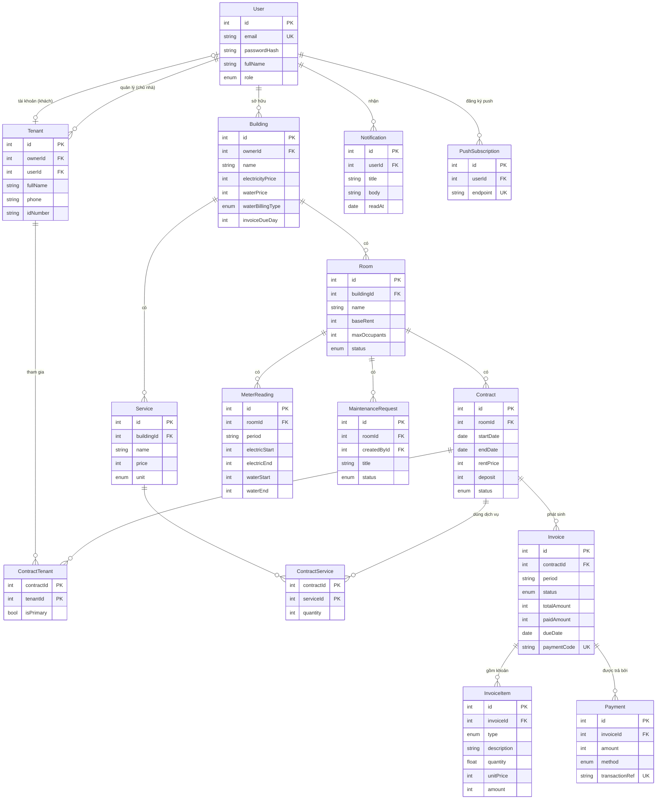

# Thiết kế database (TV2 giữ, cả nhóm review ở Tuần 2)

Nguồn chính xác nhất là [`backend/prisma/schema.prisma`](../backend/prisma/schema.prisma). Tài liệu này để **đọc hiểu** và **đưa vào báo cáo**.
Sơ đồ viết bằng [Mermaid](https://mermaid.js.org): GitHub và VS Code (extension "Markdown Preview Mermaid Support") tự vẽ thành hình.

## Giải thích các quyết định thiết kế (dùng khi vấn đáp)
| Quyết định | Lý do |
|---|---|
| Tiền lưu `Int` (VND) | Số thực bị sai số: `0.1 + 0.2 = 0.30000000000000004` |
| `Tenant` tách khỏi `User` | Không phải khách nào cũng cần tài khoản. Chủ nhà lưu hồ sơ trước, cấp tài khoản sau (`userId` có thể null) |
| `ContractTenant` (nhiều–nhiều) | Một phòng ở ghép nhiều người; một người có thể thuê nhiều lần theo thời gian |
| `Contract.rentPrice` tách khỏi `Room.baseRent` | Giá thỏa thuận có thể khác giá niêm yết; đổi giá phòng không làm sai hợp đồng cũ |
| `MeterReading` lưu cả chỉ số đầu và cuối | Hóa đơn hiển thị rõ "1250 → 1380"; sửa một tháng không ảnh hưởng tháng khác |
| `@@unique([roomId, period])`, `@@unique([contractId, period])` | Database chặn ghi trùng chỉ số hoặc hóa đơn cùng kỳ, kể cả khi code có lỗi |
| `InvoiceItem` lưu sẵn `amount` | Hóa đơn là chứng từ: đổi giá điện sau này **không được** làm thay đổi hóa đơn cũ |
| `Payment.transactionRef @unique` | **Idempotency**: cổng thanh toán gửi webhook 2 lần thì lần 2 bị chặn, không gạch nợ 2 lần |
| `Invoice.paymentCode @unique` | Mã trong nội dung chuyển khoản (VD `HD000123`) để webhook biết tiền vào thuộc hóa đơn nào |

## Quy trình sửa schema
1. Báo TV2 trong nhóm chat: "Mình cần thêm trường X vào bảng Y để làm Z"
2. Sửa `schema.prisma` trên nhánh của mình
3. `npm run db:migrate -- --name them_truong_x` → sinh thư mục mới trong `prisma/migrations/`
4. **Commit cả `schema.prisma` lẫn thư mục migration**
5. Người khác pull về thì chạy `npm run db:migrate` để áp dụng
6. Cập nhật sơ đồ ở file này và kiểu dữ liệu trong `frontend/src/types/index.ts`

## Câu hỏi để review ở Tuần 2
- [ ] Có cần lưu **lịch sử giá** (giá điện tháng trước khác tháng này) không? Hiện tại `InvoiceItem.unitPrice` đã lưu giá tại thời điểm tạo hóa đơn
- [ ] Có cần lưu **ảnh** (ảnh phòng, ảnh sự cố, ảnh công tơ) không? Nếu có thì lưu ở đâu? (Gợi ý: Cloudinary miễn phí, DB chỉ lưu URL)
- [ ] Thông tin **tài khoản ngân hàng nhận tiền** của chủ nhà (cho VietQR, Tuần 8) lưu ở `User` hay `Building`?
- [ ] Có cần **xóa mềm** (`deletedAt`) thay vì xóa hẳn không?
