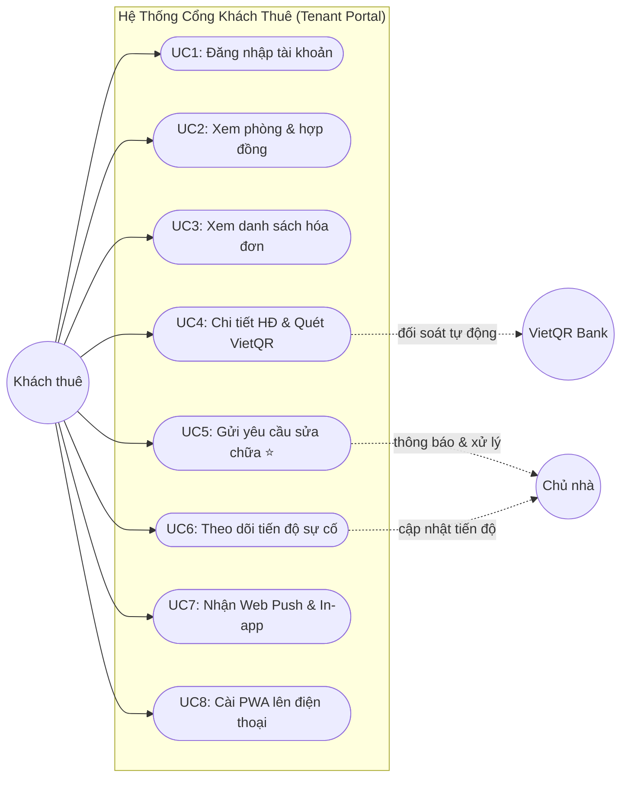
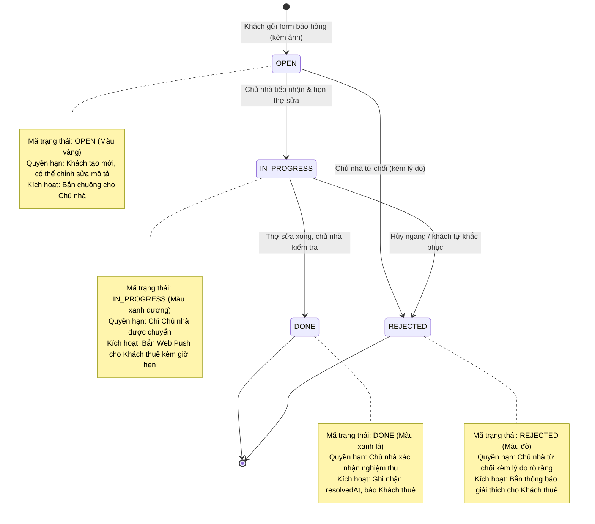
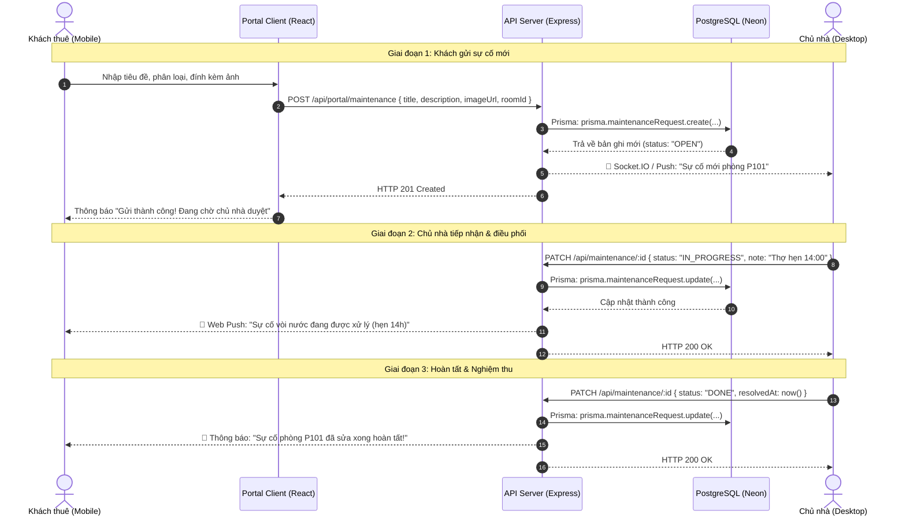

# 🛠️ Tài Liệu Phân Tích & Thiết Kế Luồng Báo Cáo Sự Cố & Cổng Khách Thuê

> **Tài liệu phục vụ Tuần 2: Phân tích & Thiết kế**  
> **Người phụ trách:** **TV4** (Phụ trách Trải nghiệm Khách thuê & Giao diện di động)  
> **Review chéo bởi:** **TV1** (Trưởng nhóm / PM)

---

## 📌 1. Bối cảnh & Mục tiêu nghiệp vụ

Khách thuê trọ thường gặp các hư hỏng vật chất trong phòng (hỏng vòi nước, cháy bóng đèn, kẹt khóa cửa, tắc cống, hỏng bình nóng lạnh). Trong thực tế:
- **Khó khăn của khách:** Thường phải nhắn tin Zalo hoặc gọi điện thoại cho chủ nhà, hay bị trôi tin nhắn, không biết khi nào thợ đến sửa, không lưu lại được lịch sử.
- **Khó khăn của chủ nhà:** Nhận phản ánh lộn xộn, quên lịch hẹn thợ, khó kiểm soát chi phí sửa chữa theo từng phòng.
- **Giải pháp của hệ thống:**
  1. Cung cấp **form báo sự cố chuẩn hóa** trên điện thoại (chọn phân loại, chụp ảnh hiện trường gửi trực tiếp).
  2. Xây dựng **luồng trạng thái minh bạch**: `OPEN` ➔ `IN_PROGRESS` ➔ `DONE` (hoặc `REJECTED`).
  3. Tự động gửi **thông báo chuông (In-app)** và **Web Push Notification** tới điện thoại của khách và chủ nhà khi có cập nhật tiến độ.

---

## 📊 2. Sơ đồ Use Case phân hệ Khách thuê (Tenant Use Case)

File ảnh vector SVG độ nét cao: [so-do-usecase-khach-thue.svg](file:///d:/2026.1/Web/House-Renting-Management-System-dev/House-Renting-Management-System-dev/docs/images/so-do-usecase-khach-thue.svg)

---

## 🔄 3. Sơ đồ Trạng thái Yêu cầu Sửa chữa (State Machine Diagram)

File ảnh vector SVG độ nét cao: [so-do-trang-thai-su-co.svg](file:///d:/2026.1/Web/House-Renting-Management-System-dev/House-Renting-Management-System-dev/docs/images/so-do-trang-thai-su-co.svg)

---

## ⚡ 4. Sơ đồ Tuần tự Luồng Báo Cáo & Xử Lý Sự Cố (Sequence Diagram)

File ảnh vector SVG độ nét cao: [so-do-tuan-tu-su-co.svg](file:///d:/2026.1/Web/House-Renting-Management-System-dev/House-Renting-Management-System-dev/docs/images/so-do-tuan-tu-su-co.svg)

---

## 🔒 5. Ma trận Phân quyền & Hành động (RBAC Matrix)

| Hành động | Khách thuê (`TENANT`) | Chủ nhà (`LANDLORD`) | Ghi chú bảo mật |
|---|:---:|:---:|---|
| **Xem danh sách sự cố** | Chỉ xem của phòng mình | Xem toàn bộ các tòa nhà sở hữu | Lọc chặt theo `roomId` và hợp đồng hiệu lực |
| **Gửi sự cố mới** | ✅ Được phép | ❌ Không (chủ không tự báo) | Mặc định gán `status = OPEN` |
| **Sửa mô tả khi còn `OPEN`** | ✅ Được phép | ✅ Được phép | Tránh khách sửa khi thợ đã bắt đầu làm |
| **Đổi sang `IN_PROGRESS`** | ❌ Không | ✅ Được phép | Khách không thể tự nhận thợ |
| **Đổi sang `DONE` / `REJECTED`** | ❌ Không | ✅ Được phép | Bắt buộc ghi nhận `resolvedAt` |
| **Xóa sự cố** | ❌ Không | ✅ Khi là dữ liệu rác | Khuyên dùng ẩn thay vì xóa cứng |

---

## 📬 6. Ma trận Thông báo Tự động (Notification Matrix)

| Mã sự kiện | Sự kiện | Người nhận | Tiêu đề mẫu | Nội dung mẫu | URL đích |
|:---:|---|---|---|---|---|
| `NOTIF_01` | Hóa đơn mới phát hành | Khách thuê | 📄 Hóa đơn kỳ 10/2026 | Hóa đơn phòng P101 là 3.250.000 đ. Hạn: 05/11. | `/portal/invoices/:id` |
| `NOTIF_02` | Khách gửi sự cố mới | Chủ nhà | ⚠️ Sự cố phòng P101 | Khách báo: Vòi nước bồn rửa bát bị rò rỉ. | `/maintenance` |
| `NOTIF_03` | Tiếp nhận sự cố | Khách thuê | 🛠️ Tiến độ: ĐANG XỬ LÝ | Yêu cầu sửa vòi nước đã tiếp nhận. Thợ hẹn 14h. | `/portal/maintenance` |
| `NOTIF_04` | Sửa xong sự cố | Khách thuê | 🟢 Tiến độ: HOÀN TẤT | Sự cố vòi nước đã sửa xong. Vui lòng kiểm tra! | `/portal/maintenance` |
| `NOTIF_05` | Từ chối sự cố | Khách thuê | 🔴 Sự cố bị từ chối | Yêu cầu bị từ chối do: Hư hỏng do sử dụng sai. | `/portal/maintenance` |
| `NOTIF_06` | Gạch nợ VietQR tự động | Khách + Chủ | 💰 Thanh toán thành công | Đã nhận 3.250.000 đ chuyển khoản cho kỳ 10/2026. | `/portal/invoices/:id` |
| `NOTIF_07` | Nhắc nợ tự động (Cron) | Khách thuê | ⏰ Nhắc đóng tiền phòng | Hóa đơn kỳ 10/2026 đã quá hạn nộp. Vui lòng thanh toán. | `/portal/invoices/:id` |

---

## 🎯 7. Liên kết bàn giao Tuần 2 của TV4

- 🎨 **File vẽ Excalidraw:** [`docs/wireframes/wireframe-tv4-khach-thue.excalidraw`](wireframes/wireframe-tv4-khach-thue.excalidraw)
- 🌐 **Trang xem Wireframe HTML:** [`docs/wireframes/wireframe-preview.html`](wireframes/wireframe-preview.html)
- 🖼️ **Ảnh Sơ đồ trạng thái:** [`docs/images/so-do-trang-thai-su-co.svg`](images/so-do-trang-thai-su-co.svg)
- 🖼️ **Ảnh Sơ đồ tuần tự:** [`docs/images/so-do-tuan-tu-su-co.svg`](images/so-do-tuan-tu-su-co.svg)
- 🖼️ **Ảnh Sơ đồ Use Case:** [`docs/images/so-do-usecase-khach-thue.svg`](images/so-do-usecase-khach-thue.svg)
