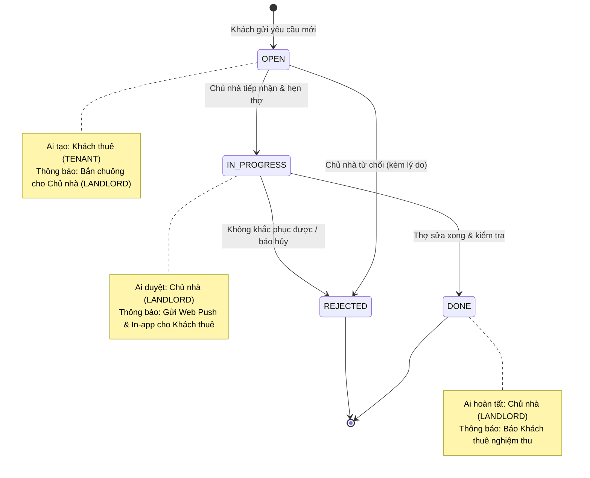

# 📱 Tài liệu Thiết Kế Wireframe & Luồng Cổng Khách Thuê (TV4 - Tuần 2)

Tài liệu thiết kế chi tiết giao diện di động (Mobile First), sơ đồ trạng thái sự cố và ma trận thông báo hệ thống phục vụ giai đoạn **Tuần 2: Phân tích & Thiết kế**.

---

## 📂 Các file thiết kế đính kèm

1. **File Excalidraw (để vẽ, sửa và xuất ảnh):**  
   👉 [`wireframe-tv4-khach-thue.excalidraw`](wireframe-tv4-khach-thue.excalidraw)  
   *(Mở trang [excalidraw.com](https://excalidraw.com) ➔ Bấm **Open** (Ctrl + O) ➔ Chọn file này để xem và chỉnh sửa toàn bộ 5 màn hình).*

2. **File xem trực tiếp trên trình duyệt (Interactive HTML Viewer):**  
   👉 [`wireframe-preview.html`](wireframe-preview.html)  
   *(Mở trực tiếp bằng Chrome/Edge để xem bản preview 5 khung máy điện thoại sắc nét, đẹp mắt).*

---

## 📱 Chi tiết 5 Màn hình Wireframe (Mobile First)

| # | Màn hình | Route | Mục đích | Thành phần chính |
|---|---|---|---|---|
| **1** | **Trang chủ khách thuê** | `/portal` | Tổng quan phòng & lối tắt | Thẻ phòng đang thuê, thẻ Hóa đơn kỳ hiện tại (số tiền to, hạn nộp, nút thanh toán nhanh), 4 nút thao tác nhanh (Báo sự cố, Điện nước, Hợp đồng, Gọi chủ nhà), widget tiến độ sự cố gần nhất. |
| **2** | **Danh sách Hóa đơn** | `/portal/invoices` | Xem lịch sử các kỳ đóng tiền | Segmented Filter (Tất cả / Chưa trả / Đã trả), danh sách thẻ hóa đơn theo tháng, trạng thái nợ/đã gạch nợ, nút chuyển sang thanh toán. |
| **3** | **Chi tiết Hóa đơn & VietQR** | `/portal/invoices/:id` | Xem chi tiết từng khoản & quét mã QR | Banner tổng tiền phải trả; **Khung mã VietQR tự động sinh kèm STK & cú pháp chuyển khoản đối soát**; Bảng chi tiết: tiền phòng, số điện cũ/mới, số nước, wifi, rác, xe; Nút In/Tải PDF. |
| **4** | **Báo sự cố phòng** | `/portal/maintenance` | Gửi yêu cầu thợ sửa chữa | Tabs (Gửi yêu cầu / Lịch sử sự cố); Phòng mặc định; Phân loại tag (Nước, Điện, Khóa, Khác); Tiêu đề; Mô tả chi tiết; Khung chụp/chọn ảnh minh họa; Nút gửi yêu cầu. |
| **5** | **Thông báo trong App** | `/portal/notifications` | Nhận tin tức & thông báo đẩy | Bộ lọc loại thông báo (Hóa đơn / Sự cố); Danh sách thông báo có chấm xanh chưa đọc; Thẻ kích hoạt Web Push Notification (PWA). |

---

## 🔄 Sơ đồ luồng trạng thái sự cố (Maintenance State Machine)

---

## 📬 Ma trận thông báo hệ thống (Notification Matrix)

| Sự kiện kích hoạt | Tác nhân kích hoạt | Người nhận | Tiêu đề mẫu | Nội dung mẫu | Link điều hướng |
|---|---|---|---|---|---|
| Phát hành hóa đơn | Chủ nhà | Khách thuê | 📄 Hóa đơn kỳ MM/YYYY | Hóa đơn phòng {room} là {amount}đ. Hạn nộp: {dueDate}. | `/portal/invoices/:id` |
| Gửi sự cố mới | Khách thuê | Chủ nhà | ⚠️ Sự cố phòng {room} | Khách báo: {title}. Nhấn để xem ảnh và xử lý. | `/maintenance` |
| Tiếp nhận sự cố | Chủ nhà | Khách thuê | 🛠️ Sự cố: ĐANG XỬ LÝ | Yêu cầu sửa {title} đã được tiếp nhận. Hẹn thợ: {time}. | `/portal/maintenance` |
| Sửa xong sự cố | Chủ nhà | Khách thuê | 🟢 Sự cố: HOÀN TẤT | Sự cố {title} đã được thợ sửa xong. Vui lòng kiểm tra. | `/portal/maintenance` |
| Thanh toán thành công | Webhook VietQR / Chủ nhà | Khách thuê | 💰 Thanh toán thành công | Đã gạch nợ thành công {amount}đ cho hóa đơn kỳ {period}. | `/portal/invoices/:id` |
| Quá hạn thanh toán | Job định kỳ (Cron) | Khách thuê | ⏰ Nhắc đóng tiền phòng | Hóa đơn kỳ {period} đã quá hạn nộp. Vui lòng chuyển khoản sớm. | `/portal/invoices/:id` |
